# elm7fza (المحفظة)
### an Egyptian-Arabic Telegram money bot

> A personal finance bot you talk to in Egyptian Arabic. It lives in your Telegram
> chat, thinks with Gemini, keeps its books in Google Sheets, and runs for $0/month
> on Google Apps Script.

**Bot:** @elm7fza_bot · **Stack:** Google Apps Script + Google Sheets + Gemini + Telegram Bot API + GitHub Actions · **Tests:** 78, all green · **Released versions:** 41

This folder is the complete documentation: what the system is, how to use it,
how every piece works, and how to build your own from zero.

## Why it exists

- Expense apps want forms and categories. My brain at the kiosk speaks Egyptian
  Arabic: «صرفت ٣٥ مواصلات». Typing that into a chat window is the lowest-friction
  accounting that exists.
- A finance bot must never lie, never lose a message, and never double-count.
  Everything in this repo is in service of those three promises.
- Money data should live somewhere I can actually open and audit: a plain
  Google Sheet, one row per transaction, no vendor lock-in.

## Feature highlights

| Area | What you get |
| --- | --- |
| Input | Quick text («50 مواصلات»), free-form narrative, voice notes, receipt photos |
| Local brain | Common phrases and simple expenses parse instantly with zero AI calls |
| AI parsing | Gemini turns messy Egyptian Arabic into structured transactions |
| Correction | Reply to any old message to edit it, or say «امسح» to delete it and get your money back in the totals |
| Runway | «فلوسي لازم تكفيني لحد آخر الشهر»: live daily allowance and burn tracking |
| Debt book | What I owe, what I'm owed, repayments that actually reduce balances |
| Reports | today, week, month, 3-month stats, top items, budgets, dashboard with charts |
| Reliability | Global poll lock, ack-before-process, write-ahead retry queue (12h), dedup by update id |
| Ops | `/doctor` self-heals triggers and menus, `/status`, `/debug`, Drive backups, CSV export |
| Deploy | One command: tests, version bump, commit, push, CI ships to Google and reports on Telegram |

## Documentation index

| File | Contents |
| --- | --- |
| [SETUP.md](docs/SETUP.md) | Build your own instance from zero: Telegram, Gemini, Sheet, clasp, CI |
| [ARCHITECTURE.md](docs/ARCHITECTURE.md) | Every file, the message lifecycle, idempotency design, data model, runway math |
| [USAGE.md](docsUSAGE.md) | The full user manual with Egyptian Arabic examples for every command |
| [DEPLOYMENT.md](docs/DEPLOYMENT.md) | deploy.sh gates, the GitHub Actions pipeline, secrets, rollback |
| [TESTING.md](docs/TESTING.md) | The vm-based test harness, the 78 tests, how to add your own |
| [SECURITY.md](docs/SECURITY.md) | Threat model, what is secret and where it lives, going-public checklist |

## Repository map

```mermaid
flowchart TB
    root["elm7fza_bot/"]
    root --> app["App.js<br/>entry points, triggers, migrations"]
    root --> context["AppContext.js<br/>dependency container, secrets"]
    root --> config["Config.js<br/>config, schemas, intents, i18n"]
    root --> core["Core.js<br/>dates, text, dedup, logging"]
    root --> models["Models.js<br/>Transaction, ExtractionResult"]
    root --> repositories["Repositories.js<br/>Google Sheets access"]
    root --> intent["IntentRouter.js<br/>quick parse and AI decision"]
    root --> finance["FinanceService.js<br/>reports, runway, debts, budgets"]
    root --> intelligence["IntelligenceService.js<br/>Gemini prompts and extraction"]
    root --> telegram["TelegramClient.js<br/>Telegram Bot API wrapper"]
    root --> gemini["GeminiClient.js<br/>Gemini API with fallbacks"]
    root --> router["Router.js<br/>dispatcher, commands, reply edits"]
    root --> retry["RetryQueue.js<br/>write-ahead retry sheet"]
    root --> polling["PollingEngine.js<br/>locked poll loop and offset ack"]
    root --> dashboard["DashboardService.js<br/>Dashboard charts"]
    root --> backup["BackupService.js<br/>Drive backups"]
    root --> manifest["appsscript.json<br/>Africa/Cairo, V8"]
    root --> deploy["deploy.sh<br/>tests, bump, commit, push"]
    root --> tests["tests/<br/>Node VM harness and suites"]
    root --> ci[".ci/<br/>auth, payload, push, verify, notify"]
    root --> workflow[".github/workflows/<br/>deploy.yml pipeline"]
```

## Quick facts

| Fact | Value |
| --- | --- |
| Source files | 16 JavaScript files (Apps Script V8) |
| Storage | Google Sheets, 8 tabs: Transactions, Categories, Budgets, Log, Prompts, Dashboard, RetryQueue, Runway |
| AI model | gemini-3.8-flash (temperature 0.2, fallbacks: gemini-flash-latest, gemini-3.5-flash) |
| Polling | 1-minute time trigger, 20s long-poll hot session, capped at 50s per run |
| Retry budget | 12 hours, 60s between attempts, 5 per cycle |
| Monthly cost | $0 within personal-use quotas |
| Language of the UI | Egyptian Arabic (with English strings available via /lang) |

## Version history highlights

| Version | The story |
| --- | --- |
| v30 baseline | Text, voice and photo input, sheets storage, reports, dashboard, backups |
| v33 | Canonical person names + case folding for the debt book |
| v34 | Runway: set an end date, get a daily allowance, live line after each save |
| v35–v36 | Honest retry texts, 12h queue, menu fixes, runway sheet config |
| v37 | Global poll lock + save dedup + `/doctor` + menu self-heal (no double processing) |
| v39 | Write-ahead queue reservation before AI calls (no more silent message loss) |
| v40 | Reply-to-edit, delete-by-reply with money-back, live Runway amount column |
| v41 | Unified debt-book names (شلبي = Shalaby), calm runway line, yearless dates, zero em dashes |

## Quick start

Want your own? Open [SETUP.md](docs/SETUP.md) and follow it top to bottom: about an
hour of clicking spread over Telegram, Google AI Studio, one Sheet, and one
GitHub repo. The license is up to the repo owner; if you build on this, a link
back is appreciated but not required.
