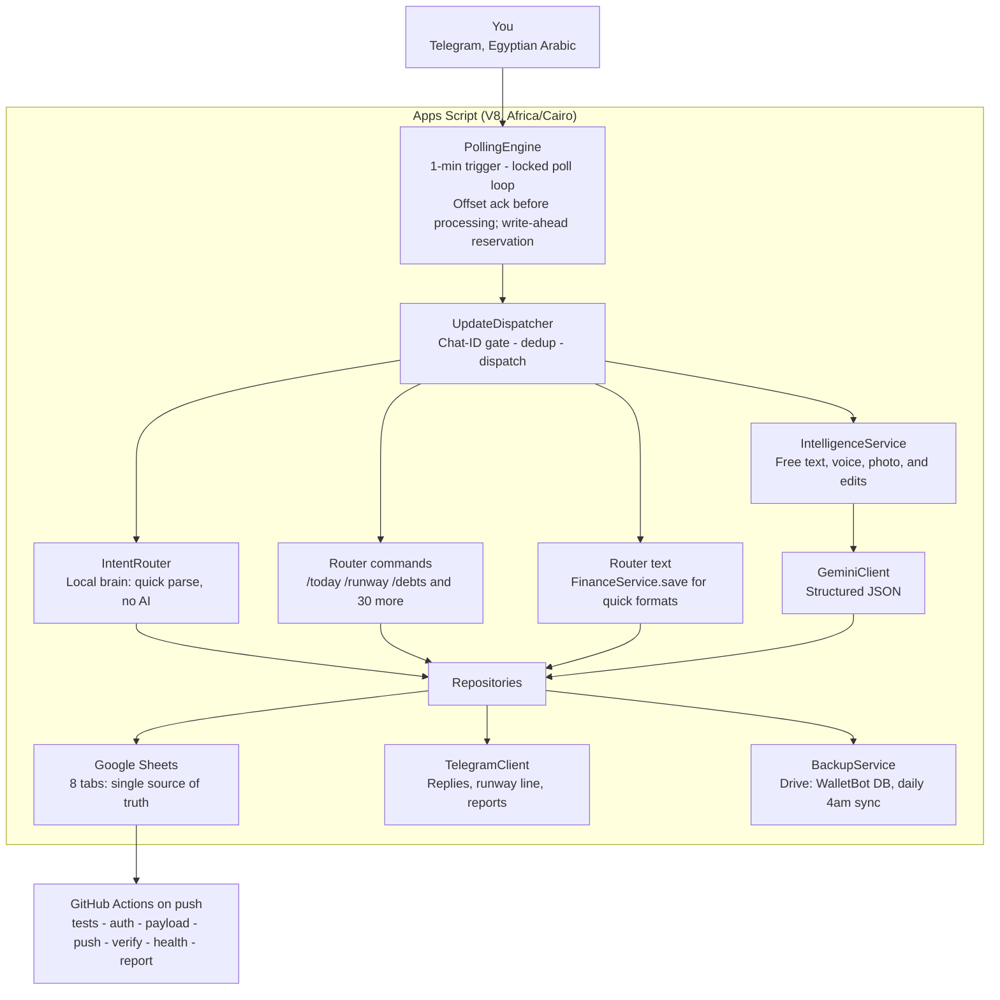

# ARCHITECTURE · how المحفظة works inside

## Bird's eye view



## The three brains

The bot never calls Gemini when it does not have to. A message takes one of
three paths:

1. **Reflexes (zero AI):** greetings, question phrases («كام صرفت النهارده؟»),
   slash commands, and quick expense formats («50 مواصلات») are handled by
   `IntentRouter` with pure string matching. Reply in milliseconds.
2. **Quick save (zero AI):** `50 مواصلات` = number + known shortcut
   (`QUICK_MAP`: اكل → Food, مواصلات → Transport, كهربا → Utilities, ...).
   Saved directly, confirmed, runway line attached.
3. **Gemini (the slow brain):** narrative messages («اتغدت انا وصاحبي ودفعت
   350 وبعدين شريت سجاير 80»), voice notes, receipt photos, and correction
   replies. `IntelligenceService` builds a strict extraction prompt (plus your
   known-people list so names stay consistent), `GeminiClient` calls the model
   at temperature 0.2, and the JSON comes back as validated `Transaction`
   objects. Fallback models kick in if the primary one is unavailable.

`needsSlowAi()` is the switch: it also decides whether the message gets a
**write-ahead reservation** before the call (see below).

## The message lifecycle (happy path)

1. Trigger fires `pollUpdates()` every minute (App.js).
2. `PollingEngine.poll()` takes the **global script lock** (`tryLock(0)`: if
   another cycle is running, this one walks away silently). One cycle at a
   time, ever.
3. `getUpdates(offset)` long-polls Telegram (20s once warm, up to 50s per run).
4. **Ack before process:** for each update, `POLL_OFFSET` is persisted
   immediately, so even a crash mid-processing can never re-fetch the message
   and double-count it.
5. If the update needs slow AI: `RetryQueue.ensureRow()` writes a reservation
   row **before** processing. If execution gets guillotined (Apps Script kills
   at ~6 minutes, and a busy Gemini can hold the line), the next cycle finds
   the row and retries: no message can die silently.
6. `UpdateDispatcher.process()`: drop if `chat.id != MY_CHAT_ID`, drop if
   `deduper.seen(update_id)`, otherwise dispatch and only then
   `deduper.mark()`.
7. Routing: button → command → text → voice → photo. Language is auto-detected
   per message (`/lang` overrides).
8. Save path: `FinanceService.save(transactions)` appends rows (with the
   original message text and message id!), refreshes the Runway amount column,
   and replies: confirmation lines + the calm runway line + budget warnings.
9. On success, the reservation row is removed. On a transient error (Gemini
   overloaded, network), the update is enqueued with backoff: 60s intervals,
   up to 12 hours, 5 attempts per cycle, with an honest heads-up message.
10. End of cycle, still under the lock: due retries run, one Drive backup
    flush happens, then the lock releases.

## Idempotency: four layers

| Layer | Mechanism | Kills |
| --- | --- | --- |
| Concurrency | global `LockService` lock, one poll cycle at a time | parallel double-processing |
| Redelivery | `POLL_OFFSET` persisted before processing | crash → re-fetch → double count |
| Repeats | `Deduper` on `update_id`, mark-after-success | Telegram retries of the same update |
| Crashes mid-AI | write-ahead reservation row + retry queue | silent message loss |

The same update can therefore be retried any number of times and still land
exactly once in the Transactions tab.

## Edit and delete by reply (v40)

Every saved row carries the Telegram `message_id`. When you reply to one of
your old messages:

```
reply to "كشف امي 200"  +  "كشف امي كان ب 600 مش 200"
```

1. `handleEditReply` loads the original rows by `message_id`.
2. Delete intent («امسح», «احذف» ...)? → rows are deleted bottom-up, the reply
   confirms «اتمسحت كلها والفلوس رجعت في حساباتك», totals recompute from the
   sheet, so the money genuinely returns.
3. Quick-format correction → deterministic re-write: delete old rows, insert
   the new one. Idempotent by construction (delete-then-insert under the lock).
4. Anything wordier → Gemini **CORRECTION MODE** with the original rows in the
   prompt, so it edits rather than appends.
5. Either way the Runway amount column is refreshed and the runway line is
   attached to the reply.

## The data model

Eight tabs, one row per transaction (source of truth is always the sheet):

```
Transactions: Date | Amount | Currency | Type | Category | Note | Original Message | Message ID | Created At
Runway:       Status | Start | End | Amount | Updated At
RetryQueue:   Update ID | Message JSON | Attempts | First Try At | Next Try At
Log:          Timestamp | Level | Event | Status | Update ID | Lang | Details | Raw   (capped 2000 rows, trimmed to 1500)
Prompts:      Key | Prompt          ← the AI prompt, editable live via /setprompt
Budgets:      Category | Monthly Limit
Categories:   Category              ← 16 seeded defaults
Dashboard:    charts, rebuilt by /dashboard
```

### Transaction kinds (the debt book)

| Kind | Sign | Cash | Meaning |
| --- | --- | --- | --- |
| `income` | + | +1 | real income |
| `expense` | − | −1 | spending |
| `loan_in` | + | +1 | borrowed, must repay |
| `repay_out` | − | −1 | debt repayment (reduces what I owe) |
| `loan_out` | − | −1 | lent out, owed to me |
| `repay_in` | + | +1 | collected a loan back |
| `loan_in_off` / `loan_out_off` | (none) | 0 | old off-book debt, tracked but excluded from cash |

`/debts` groups `loan_in − repay_out` per person (what I owe), `loan_out −
repay_in` (what I'm owed), and prints the net position. Person names are
normalized through `PERSON_MAP` plus a known-people line injected into every
AI prompt, so «شلبي», «Shalaby» and «SHALABY» are one person (v41).

### Runway math

With `Start`, `End`, `Amount` (income actually received in the period, refreshed
after every save) and today's date:

```
spentSince = sum of cash-negative kinds since Start
remaining  = Amount − spentSince
daysLeft   = max(End − today, 0)
allowed    = remaining / max(daysLeft, 1)      ← "سماح يومي"
burn       = today's spending
icon       = 🟢 if burn ≤ allowed else 🔴
```

After every save/edit/delete you get one calm line:

```
✈️ باقي 10,175 · سماحك 363 ج/يوم لحد 11-30 🔴
```

`/runway` with no arguments prints the full report: income in period, spent,
left, daily allowance, days left. Dates render without the year (the sheet
always stores full `yyyy-MM-dd`).

## Polling vs webhook

The primary transport is polling (a 1-minute trigger + 20s long polls), because
webhooks need a public HTTPS endpoint and Apps Script web apps are a poor fit
for that here. A `doPost` entry point exists, is gated by `WEBHOOK_SECRET`,
and `PollingEngine.install()` actively deletes any conflicting webhook so
Telegram never queues messages away from the poller.

## Apps Script constraints the design works around

| Constraint | The design answer |
| --- | --- |
| ~6 min max execution | poll sessions capped at 50s; AI calls are the only long step, protected by the write-ahead queue |
| Triggers are minute-granular at best | 20s long-poll keeps a hot session close to real-time |
| No real concurrency primitives | global script lock + sheet as the single source of truth |
| UrlFetchApp quotas | free-tier friendly: one getUpdates call per cycle, batched reads/writes |
| Cache is best-effort | nothing critical relies on CacheService |

## Extension points

- New command: `Router.register('name', handler)` + a `COMMAND_MENU` entry;
  `/doctor` self-heals the Telegram menu from that list.
- New category: `DEFAULT_CATEGORIES` + `CATEGORY_AR_EN` + `QUICK_MAP` entries.
- New report: a method on `FinanceService` reading through the repositories,
  plus strings in `STR` (ar/en).
- New language: every user-facing string lives in `Config.STR` as `{ar, en}`
  pairs, rendered through `I18n.t(key, lang, params)`.
