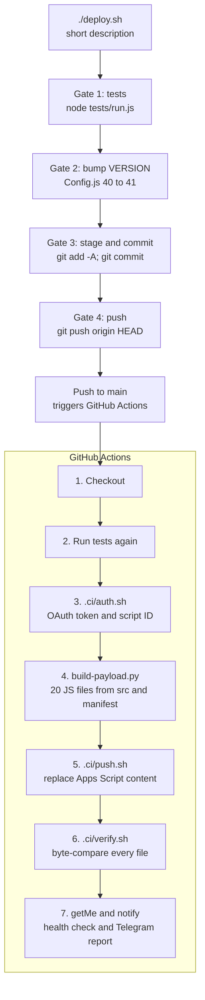

# DEPLOYMENT · from `git push` to a live bot

## The contract

The whole pipeline enforces one idea: **nothing ships unless everything is
green.** Two layers guard it, locally and in CI, and they run the same test
suite.



The workflow uses `concurrency: deploy` without cancel-in-progress, so two
pushes queue up instead of racing each other to Google.

## Why full replacement + verify

The Apps Script API's `updateContent` PUT replaces the project's files
atomically, which is exactly what we want: the project on Google is either
the old version or the new one, never a mix. `verify.sh` then downloads the
content back and compares:

- code files: byte-for-byte `diff`
- `appsscript.json`: semantic JSON compare (Google may reorder keys)

If any file differs, the run fails, you get the 🚨 message, and you know the
live bot is still running the previous version. No silent drift between repo
and production is ever allowed.

## The report on Telegram

Success:

```
✅ Deploy ناجح · Version 41

📦 9f5c76f · v41: calm runway line + no em dashes
☁️ Google Apps Script: 17 ملف وصلوا ومطابقين 100%
🤖 البوت @elm7fza_bot: حي وشغال
🔗 https://github.com/.../actions/runs/...
```

Failure says so loudly, with the hint that the code on Google may be stale,
plus the run link. The deploy is over when Telegram says so.

## Secrets

| Secret | Lives in | Powers | If leaked |
| --- | --- | --- | --- |
| `BOT_TOKEN` | Script Properties + CI secret | the Telegram bot | attacker controls the bot (send/read getUpdates briefly); rotate via BotFather `/revoke`, update both places |
| `GEMINI_API_KEY` | Script Properties | the AI brain | quota theft on your account; rotate in AI Studio |
| `CLASPRC_JSON` | CI secret only | push access to the Apps Script project | **the big one**: whoever holds it can deploy arbitrary code to your project; rotate with `clasp logout && clasp login` |
| `MY_CHAT_ID` | Script Properties + CI secret | the allowlist + reports | low risk on its own; pairs badly with a leaked token |
| `WEBHOOK_SECRET` | Script Properties (optional) | guards `doPost` | rotate by changing the property |

Runtime properties that are state, not secrets: `POLL_OFFSET`,
`LAST_UPDATE_ID`, `STORED_VERSION`, `USER_LANG`, `DB_FOLDER_ID`.

## Local development loop

```bash
node tests/run.js        # fast feedback, faked Apps Script runtime
./deploy.sh "message"    # when green: bump, commit, push, ship
```

For quick manual pushing (bypassing CI, e.g. experiments):

```bash
clasp push
```

but remember: anything pushed this way skips tests and verification, so the
repo and production can drift. `verify.sh` in the next CI run will catch the
mismatch. Prefer the pipeline.

## Rollback

The project keeps no versions of its own on Google beyond the last push, but
the repo does (git is the deployment history):

```bash
git revert <bad-commit>
git push origin HEAD
```

The pipeline redeploys the reverted code and Telegram confirms. In a true
emergency you can `clasp push` an older checkout directly, then reconcile the
repo with a follow-up commit.

## Monitoring after deploy

- The Telegram report (every deploy, success or failure).
- `/status` from the bot: version, poll offset, queue depth.
- `/doctor`: re-checks triggers, the command menu, the prompt, and heals what
  it can (v37's self-heal: menus and triggers drift when Apps Script projects
  get touched by hand, the doctor puts them back).
- The Log tab: `MSG_*`, `TX_SAVED`, `TX_EDIT`, `TX_EDIT_DELETE`, `COMMAND`,
  `BACKUP`, `RETRY_*` events, capped at 2000 rows and auto-trimmed to 1500.
- GitHub Actions history for the pipeline itself.

## Deploy etiquette that grew out of scars

- The version number lives in exactly one place (`Config.js`), and the bump is
  verified after sed touches it, because a silent no-op once shipped a "new"
  version that was actually the old one.
- The commit message format `v<N>: <description>` is load-bearing: the Telegram
  report quotes it, and the changelog keys off the number.
- Never edit the Apps Script project by hand while the pipeline owns it: the
  next verify will fail on the byte-diff. Fix it in the repo and redeploy.
